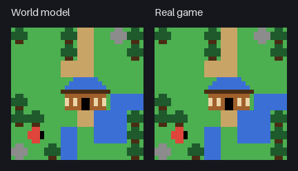
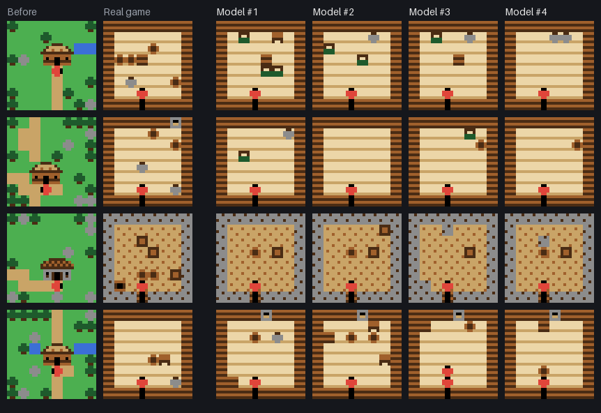
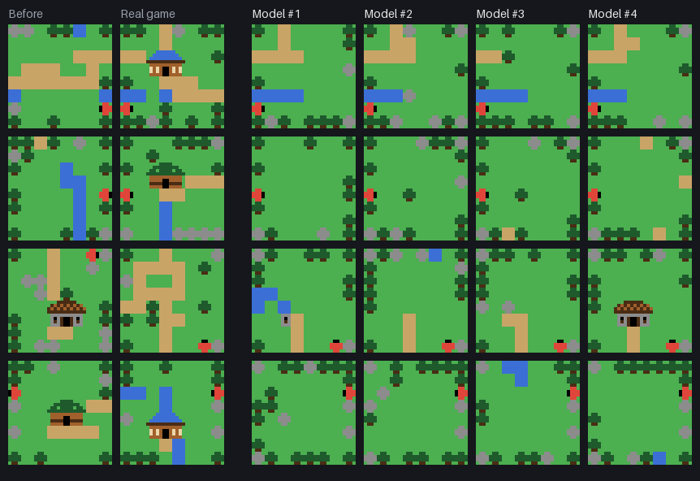

# Little Quest

[English](README.md)

ブラウザで遊べる、小さな**世界モデル**です。直前の画像（32×32ピクセル、11色）と押したキーから、次の画像を描きます。小屋に入ったり画面の端から外へ歩いたりすると、部屋や隣の画面をその場で作り出して描きます。作り出す場所は、描くたびに変わります。[Genie](https://arxiv.org/abs/2402.15391) の考え方（歩き回れる世界を、ニューラルネットワークが1コマずつ描く）を、ごく小さい規模で試したものです。

**ブラウザで遊ぶ：** https://snc2work.github.io/little-quest/



*左：すべて世界モデルが、自分の直前の画像とキーから描いた画面。右：比べるために、同じキーで動かした本物のゲーム。世界 No. 332、温度 1.0。*

## モデルが作り出すもの

上のアニメーションでは、青い屋根の浴場に入るまで、2つの世界は同じ画面です。入ると、モデルは池・植物・樽のある自分なりの浴場の部屋を作ります。外に出ると、出る前の画面に戻ります。画面の端を越えると、自分なりの新しい画面を描きます。

モデルは確率的なので、同じ画像と同じキーからでも、描くたびに違う場所になります。下の画像の各行は、同じ画像から始めています。小屋に入る1手前（1枚目）と、画面の端を越える1手前（2枚目）です。そこからモデルに次の画像を4回描かせました。壁・床・池は小屋の種類に合っていて、前の画面と共有する端はそのまま引き継いでいます。





## 考え方

- **本物のゲームは、学習用の動画を作るためだけにある。** このために小さな冒険ゲームを作りました（下の「ゲーム」を参照）。簡単なボットがゲームを歩き回り、画像とキーを記録します。モデルはゲームのルール・地図・部屋を見ません。見るのは画像とキーだけです。
- **写すのではなく、作り出す。** 初めての場所に入ったときは、当てるべき正解がありません。モデルは、つじつまの合う部屋や画面なら自由に描いてかまいません。それらしく、崩れないことだけが求められます。
- **画像をかたまりで扱う。** ゲームはすべてを 4×4 の絵を格子に並べて描いていて、学習データの画像に出てくる 4×4 のかたまりは60種類だけです。そこで画像を、このかたまりの 8×8 の並びとして扱います。モデルは各場所のかたまりを選び、画像はかたまりの表を引いて組み立てます。Genie も画像を区切った単位（トークン）で描きます。
- **確率的なモデル。** モデルは各場所について、60種類のかたまりそれぞれの確率を出し、次の画像はその確率に従って選びます。歩く・ぶつかるのように次の画像が今の画像から決まるときは、確率がほぼ1つのかたまりに集まるので、毎回同じ結果になります。新しい部屋や画面のように決まらないときは、確率が多くのかたまりに分かれるので、同じ画像と同じキーからでも違う場所になります。温度で、選び方の広がりを変えられます。世界の番号でランダムな選び方が決まるので、同じ世界をもう一度遊べます。
- **数回に分けて描く（[MaskGIT](https://arxiv.org/abs/2202.04200)）。** モデルは、全部の場所が「未定」の並びから始め、最大8回に分けて、自信のある場所から決めていきます。歩いたり木にぶつかったりするときは、1回目でほぼ全部の場所に自信を持ちます。後の回では先に決まった場所を見ながら選ぶので、ひとまとまりのかたまり（机、小屋、川）が崩れずに出ます。
- **場所を覚える仕組みは、モデルの外にある。** モデルは画像と一緒に、何が起きたか（下の「出来事」を参照）も出します。ページはそれだけを手がかりに、場所ごとの最後の画像を覚えます。前にいた場所に戻ったときは、その画像を「次の画像のうち分かっている部分」としてモデルに渡し、モデルはプレイヤーだけを描き直します。画面に出る画像は、どれもモデルが描いたものです。
- **暗転はページの演出。** 入るとき・出るときの短い暗転は、ページが加えている演出です。モデルが描いたものではありません。

## 世界モデルについて

かたまりの 8×8 の並びに対する Transformer で、パラメータは270万個です（6層、幅192、ヘッド6）。各場所について、今の画像のかたまりと、次の画像のかたまり（分かっていればそのかたまり、まだなら「未定」）を受け取り、キーと合わせて計算します。各場所について60種類のかたまりそれぞれの確率を出し、その手で何が起きたかも出します。

| | |
| --- | --- |
| 学習データ | 本物のゲームのボットによる 200 世界 × 500 手（10万手） |
| 学習 | 20,000 ステップ、バッチ 128（PyTorch） |
| 大きさ | 10.9 MB（ONNX、float32） |

ページでは [ONNX Runtime Web](https://onnxruntime.ai/) を Web Worker の中で動かします。ONNX ファイルにはネットワークの1回分の計算だけが入っています。数回に分けて描く処理と、場所を覚える仕組みは TypeScript（`src/model/`）にあります。

## ゲーム

- **画面：** 1画面は 4×4 ピクセルのマスが 8×8 並んだもの（32×32 ピクセル、11色）です。世界の番号ごとに別の世界があり、画面は上下左右にどこまでも続きます。
- **マス：** 草地と土の道は歩けます。木・岩・水は歩けません。川には、歩いて渡れる浅いマスが1つずつあります。
- **画面の端：** 画面の端から外へ歩くと、そのまま隣の画面に移ります。隣り合う画面は境目のマスを共有するので、端が通れれば向こう側も通れ、川や道は境目をまたいでつながります。画面の四隅は必ず木か岩です。
- **小屋：** 約半分の画面に小屋があります（最初の画面には必ずあります）。丸太小屋・石の倉庫・苔の小屋・浴場の4種類があり、種類で部屋の見た目（壁・床・家具）が決まります。
- **部屋：** 中身（柱、家具、宝箱）は画面ごとにランダムに決まり、世界が続く間は同じ部屋のままです。約4割の部屋に宝箱があります。宝箱にぶつかると開き、開いたまま残ります。

### 出来事

本物のゲームでは、1手ごとに次のどれかが起きます。世界モデルも、画像だけからこのどれかを出します。

| 出来事 | 起きるとき |
| --- | --- |
| `stay` | 待つ |
| `move` | 1マス歩く |
| `bump` | 木・岩・水・壁・家具に向かって歩き、その場にとどまる（向きだけ変わる） |
| `open` | 閉じた宝箱に向かって歩く |
| `enter` | 小屋の扉のすぐ下の道で上を押す |
| `exit` | 部屋の出口のすぐ上で下を押す |
| `cross` | 画面の端から外へ歩く |

[本物のゲームの小屋と部屋](https://snc2work.github.io/little-quest/gallery.html) のページでは、本物のゲームの 5×5 画面の地図と、小屋の種類ごとの部屋の例を見られます。

## 動かし方

Node.js 22.12 以降が必要です。

```bash
npm install
```

```bash
npm run dev
```

表示された URL（たいてい `http://localhost:5173`）を開きます。pnpm の場合は `pnpm install` と `pnpm dev` です。

## 遊び方

上の欄で、世界の番号（World No.）と温度（Temperature）を決めます。**Random** で新しい番号を選び、**Restart** で同じ世界を最初からやり直します。

**世界の番号**は本物のゲームの世界を決め、モデルのランダムな選び方の種（シード）も兼ねます。同じ番号・同じキー・同じ温度なら、モデルの世界も同じになります。**温度**は、モデルがどのくらい自由に選ぶかです。0 では毎回いちばん確率の高いかたまりを選びます。低いとありがちで落ち着いた場所に、高いと物が多く変わった場所になります。変えた温度は次の手から反映されます。

| 操作 | キーボード | ボタン |
| --- | --- | --- |
| 移動 | 矢印キー または WASD | ▲ ▼ ◀ ▶ |
| 待つ | スペース | Wait |
| 中に入る | 小屋の扉のすぐ下の道に立って上 | |
| 外に出る | 部屋の出口のすぐ上に立って下 | |

アドレスに設定が残ります（例：`https://snc2work.github.io/little-quest/?seed=332&t=1.0`）。

## 世界モデルで遊ぶ

ページを開くと、モデル（約11 MB）を読み込んで、ランダムな世界が始まります。モデルの世界は、本物のゲームの最初の画像から始まり、2つの世界には同じキーが入ります。プレイヤーが初めて新しい場所に行くまでは、2つの世界は同じ画像です。そこから先はモデルが自分なりの世界を描き、右の本物のゲームは、同じキーで本物の世界がどうなるかを見せます。

### 画面の見方

- **World model（左）：** モデルの世界。**Real game（右）：** 同じキーで動かした本物のゲーム。
- **Stats：**
  - 手数と、モデルの1手あたりの時間
  - 今2つの世界が同じ画像か、最初に分かれた手
  - モデルが考えるプレイヤーの居場所（画面、部屋の中かどうか）と、覚えている場所の数
  - それぞれの世界で各出来事が起きた回数の表
- **History：** 最近の手と、そのキー、それぞれの世界で起きた出来事。「(remembered)」は、前に描いた場所に戻った手です。

## 結果

学習に使っていない20の世界（1万手）で測りました。

### 本物の画像から1手先を描く

本物の画像から、モデルに次の画像を描かせました。待つ・歩く・ぶつかる・宝箱を開けるときは、次の画像が今の画像から決まるので、本物のゲームと完全に一致するべきです。小屋に入る・新しい画面へ移るときは新しい場所に行くので、一致しなくてかまいません。そちらは「見たことのある 2×2 の並び」で、絵がまとまっているかを見ます。描いた画像の 2×2 のかたまりの並びのうち、学習データの画像にも出てくるものの割合です。

| 手 | 完全一致 | 出来事の正解 | 見たことのある 2×2 の並び | プレイヤーが出ている |
| --- | ---: | ---: | ---: | ---: |
| 待つ | 99.7% | 100% | 99.3% | 99.7% |
| 歩く | 100% | 100% | 99.4% | 100% |
| ぶつかる | 99.7% | 100% | 99.2% | 100% |
| 宝箱を開ける | 100% | 100% | 98.2% | 100% |
| 小屋に入る（新しい部屋） | – | 100% | 98.6%（本物：99.0%） | 98.1% |
| 新しい画面へ移る | – | 100% | 98.8%（本物：99.7%） | 100% |

「本物」は、比べるために本物の次の画像で同じように測った値です。

### 自分の描いた画像から300手続ける

20の世界、ボットのキー、温度 1.0。

| 手 | プレイヤーが出ている | 見たことのある 2×2 の並び | 歩く間に景色が変わらない | 絵どおりに動く |
| --- | ---: | ---: | ---: | ---: |
| 1–50 | 100% | 99.4% | 100% | 100% |
| 51–100 | 98.8% | 99.6% | 100% | 100% |
| 101–150 | 100% | 99.8% | 100% | 100% |
| 151–200 | 100% | 99.2% | 100% | 100% |
| 201–250 | 100% | 99.3% | 100% | 100% |
| 251–300 | 100% | 99.3% | 100% | 100% |

- **歩く間に景色が変わらない：** 待つ・歩く・ぶつかるとき、プレイヤーから離れた場所のかたまりがそのまま残る割合。
- **絵どおりに動く：** 地面に見えるかたまり（学習データでプレイヤーが乗ったことのあるかたまり）へは進み、それ以外の前では止まる割合。
- **2つの世界が分かれる所：** モデルの世界は、最初の新しい場所までは本物のゲームと完全に同じです（中央値で10手目まで）。20の世界すべてで、最初に違いが出るのは小屋に入ったときか新しい画面に移ったときで、歩いている途中で違いが出ることはありませんでした。

### 小さな崩れ

- 新しい画面の小屋が、ときどき崩れます（屋根の一部がずれる）。
- 川がときどき途切れ、草地に水のかたまりが1つだけ浮きます。
- 新しい画面は、本物より物が少なくなりがちです。
- まれに、新しい部屋でプレイヤーが2人描かれます（上の部屋の画像の一番下の行）。

### 最初はうまくいかなかったこと

最初のモデルは、ピクセルの色を1つずつ別々に選んでいました。歩く・ぶつかるはこのモデルと同じくらい当たりましたが、新しい部屋や画面は点が散らばった絵になりました。1つの机のピクセルが別々に決まるので、机の形にならなかったためです。4×4 のかたまりごとに選ぶようにして直りました。

## モデルの学習について

モデルは別のプロジェクトで、Python と PyTorch で学習しました。そのコードはこのリポジトリに含めていません。ここにあるのは、書き出したモデル（`public/models/`）、それをページで動かすコード（`src/model/`）、そしてテスト（`tests/worldModel.test.ts`）です。テストでは、2つの世界の150手ずつについて、ページのコードが学習側のコードとまったく同じ画像を描くことを確かめます。場所を覚える仕組みも含め、温度0で行います。

1. **データ。** ボットが200の世界を500手ずつ歩きました（`npm run dataset`）。ほかに確認用に20の世界、最終テスト用に20の世界を取り分けています。
2. **かたまり。** 学習データのすべての画像から 4×4 のかたまりを集めました（60種類）。確認用の世界の画像も、すべてこの60種類でできています。
3. **学習。** MaskGIT と同じように、次の画像の場所の一部をランダムに隠し、今の画像・キー・残った場所から、隠した場所を埋めるように学習しました。2つの画像の間で変わる場所は損失の重みを4倍にしました。数の少ない手（開ける・入る・出る・移る）は多めに出しました。
4. **書き出し。** ネットワークの1回分の計算を ONNX に書き出し、PyTorch と比べました。点数の差は最大でも 2×10⁻⁵ で、選ぶかたまりと出来事に違いはありませんでした。

## 開発者向け

ゲームを変えたい人や、このゲームで自分の世界モデルを学習したい人向けです。TypeScript と Vite で作っています。画像は Canvas 2D で描き、世界モデルは ONNX Runtime Web で動かします。

### コマンド

| コマンド | すること |
| --- | --- |
| `npm run dev` | 開発用サーバーを起動 |
| `npm run build` | 型チェックと本番用ビルド（`dist/`） |
| `npm test` | 単体テスト（ページのモデルのコードを学習側のコードと突き合わせるテストを含む） |
| `npm run dataset -- <オプション>` | 本物のゲームから世界モデルの学習データを作る |

### ファイル

```
src/
  game/      本物のゲーム（純粋な関数：画面、小屋、部屋、1手の処理、描画）。Node.js でも動く
  dataset/   本物のゲームを歩くボットと、エピソードの記録
  model/     ページの世界モデル：かたまり、数回に分けて描く処理、場所を覚える仕組み、Web Worker
  ui/        画像をキャンバスに描く
  lib/       種付きの乱数
  main.ts    デモのページ
  gallery.ts 本物のゲームの小屋と部屋
public/models/blocks-v1/
  world.onnx   ネットワークの1回分の計算
  model.json   60種類のかたまり、パレット、キーと出来事の名前、描き方の設定
scripts/
  dataset.ts   世界モデルの学習データ
tests/
  fixtures/    学習側のコードが描いた画像（ページのテスト用）
```

### 世界モデルの学習データ

```bash
npm run dataset -- --train 200 --val 20 --test 20 --steps 500 --out data/v1
```

1エピソードが1つの世界です。ボットは最初の画面から `--steps` 手だけ遊びます。小屋の扉・宝箱・部屋の出口・画面の端へ向かいながら、ランダムな1手や待機も混ぜます。分割ごとに世界の番号を分けています（train は 1 から、val は 1000001 から、test は 2000001 から）。同じコマンドをもう一度実行すると、書き終わったエピソードは飛ばします。

| ファイル | 中身 |
| --- | --- |
| `manifest.json` | パレット、キーと出来事の名前、集計 |
| `<split>/ep-<world>.frames` | 32×32 のパレット番号の画像が `steps + 1` 枚（1ピクセル1バイト） |
| `<split>/ep-<world>.json` | 1手ごとのキーと出来事、画像ごとの場面（外か部屋の中か）と画面 |

場面と画面は分析用です。世界モデルには渡しません。

## ライセンス

[MIT](LICENSE)
