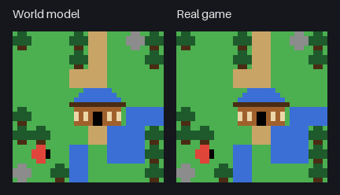
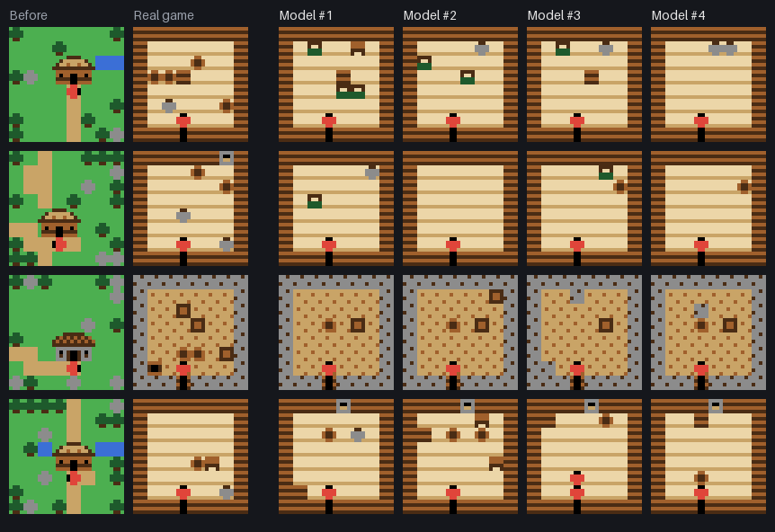
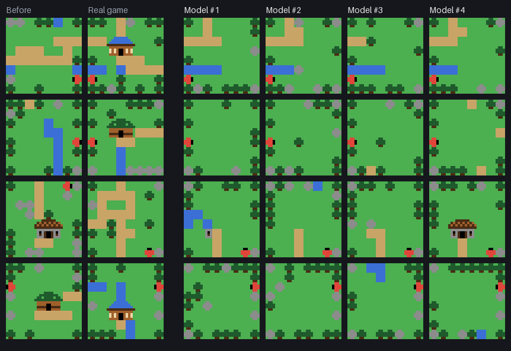

# Little Quest

[日本語](README.ja.md)

A tiny **world model** you can play in the browser. It looks at the last frame (32×32 pixels, 11 colors) and your key, and draws the next frame. Walk into a hut or off the edge of the screen, and it makes up the room or the next screen on the spot. It is a toy-sized take on the idea behind [Genie](https://arxiv.org/abs/2402.15391): a world you can walk around in, drawn frame by frame by a neural network.

**Play it in your browser:** https://snc2work.github.io/little-quest/



*World No. 332, temperature 1.0. Left: every frame drawn by the model from its own last frame. Right: the real game, with the same keys. The two match until the player enters the blue-roofed bathhouse. There the model makes up its own bath room, with a pool, plants and barrels. Back outside, the screen it left comes back. Across the edge, it draws a new screen of its own.*

## What the model makes up

Each row starts from the same frame, one step before going into a hut (top) or across the edge of the screen (bottom). Each time the model draws the next frame, it makes a different place. The walls, floor and pool match the kind of hut. The edge shared with the screen you came from carries over.





## Approach

- **The real game only makes training videos.** A small adventure game was written for this project (TypeScript, `src/game/`): endless screens with trees, rocks, rivers, paths and huts of four kinds. Each hut has a room with furniture and sometimes a chest. A simple bot walks around it and records frames and keys. The model never sees the rules, the maps or the rooms. It sees only frames and keys.
- **Generate, do not copy.** When the player goes somewhere new, there is no right answer to predict. The model is free to draw any room or screen that fits. It only has to be believable and to hold together.
- **Frames as blocks.** The game draws everything from 4×4 pictures on a grid, and the training frames contain only 60 different 4×4 blocks. A frame is treated as an 8×8 grid of those blocks. The model picks one block per cell, and the frame is put back together by looking the blocks up. Genie similarly works on image tokens.
- **Drawn over a few rounds (MaskGIT).** The model starts from a grid where every cell is unknown and fills it in over up to 8 rounds, the cells it is surest about first. When walking or bumping into a tree, it is sure of almost every cell in the first round. In a new room it samples, so the blocks that go together (a table, a hut, a river) come out whole and differ every time.
- **A small memory of places, outside the model.** Along with each frame, the model also says what happened: move, bump, open, enter, exit or cross. From that alone, the page keeps the last frame of each place. When the player goes back somewhere, that frame is handed to the model as the known part of the next frame, and the model only draws the player again. Every frame shown is still drawn by the model.
- **The black fade is the page's.** The short black screen when going in or out is a display effect added by the page. It is not drawn by the model.

## About the world model

A Transformer over the 8×8 grid of blocks, with 2.7 million parameters (6 layers, width 192, 6 heads). For each cell it gets the block of the current frame and the block of the next frame if already known (or "unknown"), plus the key. It gives a score for each of the 60 blocks in every cell, and the event of the step.

| | |
| --- | --- |
| Training data | 200 worlds × 500 steps (100,000 steps) from the real game's bot |
| Training | 20,000 steps, batch 128 (PyTorch) |
| Size | 10.9 MB (ONNX, float32) |

In the page it runs with [ONNX Runtime Web](https://onnxruntime.ai/) inside a Web Worker. Only one pass of the network is in the ONNX file. The rounds of drawing and the memory of places are in TypeScript (`src/model/`).

## Results

Measured on 20 worlds not used for training (10,000 steps).

**One step from a real frame.** These are the steps whose next frame follows from the current one. A 2×2 window counts as seen when the same 2×2 blocks also occur in the training frames.

| Step | Exact frame | Event right | 2×2 windows seen | Player shown |
| --- | ---: | ---: | ---: | ---: |
| Wait | 99.7% | 100% | 99.3% | 99.7% |
| Move | 100% | 100% | 99.4% | 100% |
| Bump | 99.7% | 100% | 99.2% | 100% |
| Open a chest | 100% | 100% | 98.2% | 100% |
| Enter a hut (a new room) | – | 100% | 98.6% (real: 99.0%) | 98.1% |
| Cross to a new screen | – | 100% | 98.8% (real: 99.7%) | 100% |

New rooms and screens are not supposed to match the real game. For those, the share of 2×2 windows of blocks that also occur in the training frames shows whether the picture holds together. The real frames score 99.0% and 99.7% on the same measure.

**300 steps from its own frames.** 20 worlds, with the bot's keys, temperature 1.0.

| Steps | Player shown | 2×2 windows seen | Scenery kept while walking | Moves follow the picture |
| --- | ---: | ---: | ---: | ---: |
| 1–50 | 100% | 99.4% | 100% | 100% |
| 51–100 | 98.8% | 99.6% | 100% | 100% |
| 101–150 | 100% | 99.8% | 100% | 100% |
| 151–200 | 100% | 99.2% | 100% | 100% |
| 201–250 | 100% | 99.3% | 100% | 100% |
| 251–300 | 100% | 99.3% | 100% | 100% |

- **Scenery kept while walking:** blocks away from the player stay the same while waiting, walking or bumping.
- **Moves follow the picture:** the player walks onto blocks that look like ground (blocks the player stood on in the training data) and stops in front of others.
- **Where the worlds part:** the model's world matches the real game exactly until the first new place (a median of 10 steps). In all 20 worlds it first differs on entering a hut or crossing to a new screen, never while walking.

### Small flaws

- A hut on a new screen sometimes comes out broken (part of the roof shifted).
- A river sometimes stops short, and a single water block floats in the grass.
- New screens tend to be emptier than the real ones.
- Rarely, the player shows up twice in a new room (see the bottom row of the room picture above).

### What did not work first

The first model picked the color of each pixel, each on its own. It walked and bumped as well as this one, but new rooms and screens came out as scattered dots. The pixels of one table were chosen separately and never formed a table. Picking whole 4×4 blocks fixed this.

## Reading the page

- **World model (left):** the model's world. **Real game (right):** the same keys in the real game, for comparison.
- **Temperature:** how freely the model samples. 0 always takes the most likely block. Low values give plain, likely places, and high values give busier, odder ones. It applies from the next step.
- **World No.:** the real game's world, and the seed of the model's random choices. The same world number, keys and temperature give the same model world. **Random** picks a new number.
- **Stats:** steps, the model's time per step, whether the two worlds show the same frame now, where they first parted, where the model thinks the player is, and how many places it remembers. The table counts each event in both worlds.
- **History:** the latest steps, with the event in each world. "(remembered)" marks a step that went back to a place drawn before.
- The address keeps the settings: `?seed=332&t=1.0`.

| Action | Keyboard | Buttons |
| --- | --- | --- |
| Move | Arrow keys or WASD | ▲ ▼ ◀ ▶ |
| Wait | Space | Wait |
| Go inside | Stand on the path right below a hut door and press Up | |
| Go out | Stand above the room's exit and press Down | |

The page [The real game's huts and rooms](https://snc2work.github.io/little-quest/gallery.html) shows the real game: a map of 5×5 screens, and example rooms of each hut kind.

## Quick start

Requires Node.js 22.12 or later.

```bash
npm install
```

```bash
npm run dev
```

Open the URL it prints (usually `http://localhost:5173`).

| Command | What it does |
| --- | --- |
| `npm run dev` | Start the development server |
| `npm run build` | Type-check and build for production (`dist/`) |
| `npm test` | Unit tests, including the check of the model code against the training code |
| `npm run dataset -- <options>` | Generate training data from the real game |

### Files

```
src/
  game/      The real game, as pure functions (screens, huts, rooms, steps, drawing)
  dataset/   The bot that walks the real game, and episode recording
  model/     The world model in the page: blocks, rounds of drawing, memory of places, Web Worker
  ui/        Drawing frames on a canvas
  lib/       Seeded random numbers
  main.ts    The demo page
  gallery.ts The real game's huts and rooms
public/models/blocks-v1/
  world.onnx   One pass of the network
  model.json   The 60 blocks, palette, key and event names, drawing settings
scripts/dataset.ts   Training data
tests/fixtures/      Frames drawn by the training code, for the page's test
```

### Training data

```bash
npm run dataset -- --train 200 --val 20 --test 20 --steps 500 --out data/v1
```

Each episode is one world. The bot plays `--steps` steps from the first screen. It heads for hut doors, chests, room exits and screen edges, with some random steps and waits mixed in. Each episode writes `<split>/ep-<world>.frames` (`steps + 1` frames of 32×32 palette indices, 1 byte per pixel) and `<split>/ep-<world>.json` (keys, events, scene and screen per step). `manifest.json` holds the palette, the key and event names, and counts. Splits use different world numbers: train from 1, val from 1000001, test from 2000001.

## How the model was trained

The model was trained in a separate project with Python and PyTorch. That code is not part of this repository. What ships here are the exported model (`public/models/`), the code that runs it in the page (`src/model/`), and a test (`tests/worldModel.test.ts`). The test checks that the page's code draws exactly the same frames as the training code, for 150 steps in each of two worlds. It covers the memory of places and uses temperature 0.

1. **Data.** The bot above walked 200 worlds for 500 steps each. 20 more worlds were kept aside for checking, and 20 for a final test.
2. **Blocks.** The 4×4 blocks of all training frames were collected (60 kinds). Every frame of the checking worlds is made of the same 60.
3. **Training.** As in MaskGIT, a random share of the next frame's cells was hidden, and the model learned to fill them in from the current frame, the key and the cells left. Cells that change between the two frames counted 4 times more. Rare steps (open, enter, exit, cross) were drawn more often.
4. **Export.** One pass of the network was exported to ONNX and checked against PyTorch. The largest score difference was 2×10⁻⁵, and no cell or event differed.

## License

[MIT](LICENSE)
